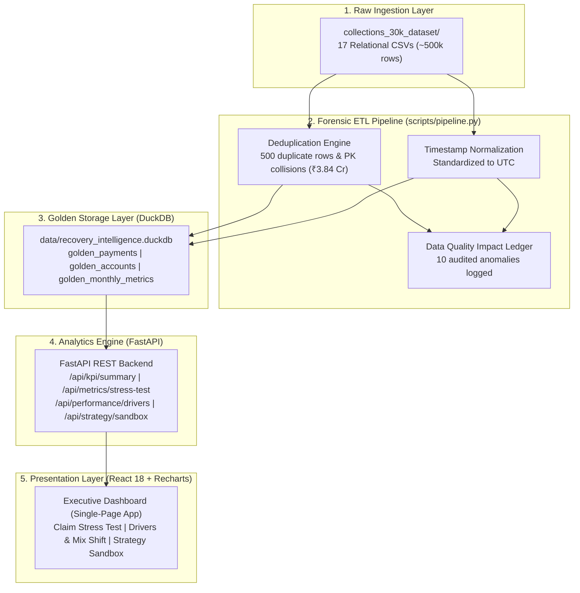

# RECOVERY INTELLIGENCE LAB (RIL)
### Forensic Collections Analytics, Metric Integrity Audit & ₹10 Cr Capital Allocation Platform

[](https://www.python.org/)
[](https://duckdb.org/)
[](https://fastapi.tiangolo.com/)
[](https://react.dev/)
[](https://github.com/GeedipalliVasu/recovery-intelligence-lab/actions/workflows/ci.yml)

---

## 1. The Business Question & Executive Summary

> **The Question**: Management reports that collections recovery improved by **11% month-on-month** (February to March 2026). Leadership is skeptical. Is this improvement real, correctly calculated, statistically credible, and attributable to better collection performance? Furthermore, where should leadership deploy a **₹10 Cr capital investment**?

### The Forensic Reality
1. **The 11% Claim is a Calendar Duration Artifact**: Gross raw collections rose from **₹17.41 Cr** (Feb) to **₹19.32 Cr** (Mar) — exactly **+10.99%** unadjusted nominal growth. However, February had 28 days while March had 31 days (**+10.71% more calendar days**).
2. **True Daily Productivity is Flat (+0.29%)**: Daily normalized collections moved from **₹60.77 Lakhs/day** to **₹60.94 Lakhs/day**. Welch's two-sample t-test yields $p = 0.9324$ and bootstrap 95% CI spans [-₹3.65L/day, +₹4.20L/day]. The data fails to reject the null hypothesis of equal daily recovery productivity; 97.4% of the nominal growth is explained by the 3 additional operational calendar days in March.
3. **Data Quality Distortions**: The raw dataset contains **486 exact duplicate rows** (₹3.73 Cr) and **14 primary key collisions** (₹0.11 Cr), totaling **500 duplicate rows dropped** (**₹3.84 Cr**), leaving 25,000 clean records. Additionally, **7,620 non-settled payments** (Failed, Pending, Reversed) total **₹57.58 Cr** that artificially distort unscrubbed reporting.
4. **The Attribution Fallacy**: While 94.8% of paying accounts were contacted via voice dialer, **94.6% of non-paying accounts were also contacted**. Dialing volume did not drive incremental lift; debtor self-cure explains baseline recovery.
5. **Traceable ₹10 Cr Investment Recommendation**: Deploy capital into **Option 4: Better Borrower Targeting & ML Propensity Allocation Engine**. Target priority book of **₹380.78 Cr** (10,000 accounts). With a conservative **+35.35% targeting lift** on an **₹80.64 Cr/year annualized baseline** (+0.748 pp of targeted balance), expected incremental recovery is **₹28.50 Cr**, yielding a **2.85x ROI** (**₹18.50 Cr net profit**) and a **4.2-month break-even**, de-risked via an orthogonal 80/20 A/B Randomized Controlled Trial (RCT).

---

## 2. Deliverables Mapping Checklist (Assignment Evaluation)

Every deliverable required by the assignment brief has been implemented, validated, and placed in the repository:

| Required Deliverable | Repository Location | Status |
| :--- | :--- | :--- |
| **1. SQL Repository** | `sql/01_raw_vs_clean_recovery.sql`<br>`sql/02_daily_run_rate_normalization.sql`<br>`sql/03_risk_segment_performance.sql`<br>`sql/04_data_quality_reconciliation.sql`<br>`sql/05_operational_metrics_challenge.sql`<br>`sql/06_counterfactual_targeting.sql`<br>`sql/07_ten_crore_investment_targeting.sql` | **Complete** (Validated in DuckDB) |
| **2. Analysis Notebook** | `notebooks/recovery_intelligence_investigation.ipynb` | **Complete** (All 15 cells executed) |
| **3. Golden Dataset / Pipeline** | `scripts/pipeline.py`<br>`data/recovery_intelligence.duckdb` | **Complete** (DuckDB + JSON exports) |
| **4. Data Quality Report** | `docs/DATA_QUALITY_REPORT.md` | **Complete** (10 audited issues & impact ledger) |
| **5. Executive Dashboard** | `frontend/` (React + Vite + Recharts)<br>Served on `http://127.0.0.1:8000/` | **Complete** (Interactive 1-screen CEO UI) |
| **6. Executive Memo** | `reports/EXECUTIVE_MEMO.md` | **Complete** (Max 2 pages, 5 mandated questions, ₹10 Cr decision) |
| **7. Architecture Diagram** | `docs/ARCHITECTURE.md` | **Complete** (Mermaid production system design) |
| **8. Metric Definitions** | `docs/METRIC_DEFINITIONS.md` | **Complete** (Challenges 9 operational metrics) |
| **9. Decision Log** | `docs/DECISION_LOG.md` | **Complete** (Architecture Decision Records) |

---

## 3. Architecture & Tech Stack



### Technology Choices & Rationale
* **Data Processing & Database**: **DuckDB & Pandas**. High-performance vectorized columnar SQL executed in-process without requiring heavy external database servers.
* **Backend**: **FastAPI & Uvicorn**. Asynchronous, type-safe REST API with Pydantic request validation and interactive Swagger documentation.
* **Frontend**: **React 18 + Vite + Recharts**. Clean, restrained financial analytics design with zero bloat.
* **Statistical Rigor**: **SciPy**. Welch's two-sample t-test, Mann-Whitney U, Kolmogorov-Smirnov test, and non-parametric bootstrap resampling ($n = 5,000$).

---

## 4. Quick Start & Execution Guide

### Prerequisites
* Python 3.10+ (with Anaconda or standard Python)
* Node.js v18+ and npm

### Step 1: Clone & Environment Setup (PowerShell)
```powershell
# Navigate to repository root
cd c:\Users\2024\OneDrive\Desktop\assessment

# Install Python requirements
pip install -r requirements.txt
```

### Step 2: Run the Ingestion Pipeline & Build Golden Dataset
```powershell
# Ingests raw CSVs, scrubs duplicates, and builds data/recovery_intelligence.duckdb
python scripts/pipeline.py
```

### Step 3: Run the Automated Test Suite (16 Tests)
```powershell
python -m pytest tests/ -v
```

### Step 4: Launch the Full-Stack Dashboard (One-Click)
Run the one-command launcher to verify databases, launch the server, and automatically open the executive dashboard in your browser:
```powershell
python run.py
```
*(On Windows, you can also simply double-click `run.bat`)*

Alternatively, you can run Uvicorn directly:
```powershell
python -m uvicorn backend.main:app --host 127.0.0.1 --port 8000
```
Open your browser to:
* **Interactive Executive Dashboard**: [http://127.0.0.1:8000/](http://127.0.0.1:8000/)
* **Interactive API Documentation (Swagger)**: [http://127.0.0.1:8000/docs](http://127.0.0.1:8000/docs)

### Step 5: Run the Analysis Notebook
```powershell
jupyter notebook notebooks/recovery_intelligence_investigation.ipynb
```

---

## 5. Signature Features

### 1. Claim Stress Test (8 Defensible Scenarios)
Allows executives to test the 11% claim under 8 transparent scenarios:
* **Scenario 1 (Management Raw Claim)**: +10.99% (Misleading: conflates 28d vs 31d).
* **Scenario 2 (Deduplicated Total)**: +11.03% (Incomplete: still unnormalized for days).
* **Scenario 3 (Daily Run-Rate — Primary Defensible)**: **+0.29%** (Defensible: Welch's t-test $p = 0.932$).
* **Scenario 4 (Distinct Paying Accounts)**: +0.55% daily debtor penetration.
* **Scenario 5 (Portfolio Balance Recovery Rate)**: 1.62% -> 1.80% (+0.18 pp, +11.0% relative, calendar-driven).
* **Scenario 6 (Winsorized 99th-Percentile)**: +0.27% daily (confirms no whale payment distortion).
* **Scenario 7 (Kitagawa Mix-Standardized)**: +0.26% daily (confirms no Simpson's paradox).
* **Scenario 8 (All Ingested Records)**: +12.23% (Invalid: includes failed and reversed money).

### 2. Evidence Trace Lineage Inspector
Every core metric in the dashboard features an audit drill-down displaying:
* Exact mathematical formula
* Active reporting window
* Audited numerator and denominator
* Count of included vs excluded records
* Executable DuckDB SQL query
* Documented assumptions and caveats

### 3. Collection Strategy Sandbox & Traceable ₹10 Cr ROI Forecast
Interactive targeting simulator pairing debt prioritization rules (DPD bands, collector capacity) with:
* **Traceable Financial Model:** Explicit targeting lift assumptions (+35.35% lift on targeted ₹380.78 Cr book $\rightarrow$ ₹28.50 Cr incremental recovery, 2.85x ROI, 4.2-month break-even).
* **Causal RCT Protocol:** An explicit **A/B Randomized Controlled Trial (RCT) Pilot Design** (80% treatment, 20% holdout, MDE power calculation, and stopping guardrails).

---

## 6. Project Evaluation Summary
Prepared for the Data Analyst / Analytics Engineer hiring evaluation. All findings, code, SQL scripts, and statistical tests are reproducible and verifiable from the source files.

