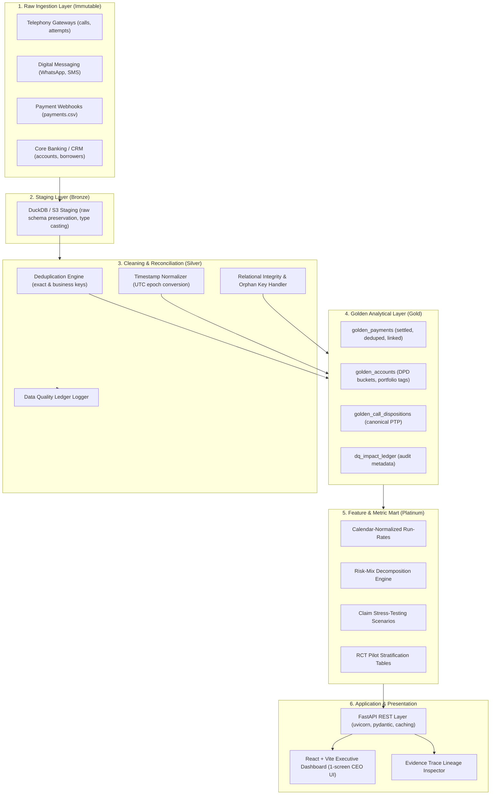

# PRODUCTION ANALYTICS SYSTEM ARCHITECTURE

**System Name**: Recovery Intelligence Platform  
**Target SLA**: Daily Refresh by 06:00 UTC (Sub-second query response on executive dashboard)  
**Status**: Production Architecture Document  

---

## 1. End-to-End System Architecture

---

## 2. Production Pipeline Specification

### A. Data Contracts & Primary Key Standards
* **Accounts Contract:** Primary key `account_id` (string pattern `ACC\d{7}`). Invariants: `outstanding_amount >= 0`, `principal_amount > 0`, `dpd >= 0`. Schema enforcement rejects negative balances or missing account identifiers.
* **Payments Contract:** Primary key `payment_id` (unique transaction UUID). Foreign key `account_id`. Invariants: `amount > 0`, `payment_status IN ('SUCCESS', 'PENDING', 'FAILED', 'REVERSED')`. Deterministic deduplication rule: if duplicate `payment_id` is ingested, row with status `SUCCESS` and earliest `event_at` supersedes all others.

### B. Incremental Processing & Watermarking
* Ingestion uses **high-watermark micro-batching** based on `event_at` timestamp.
* Watermark lag is set to **48 hours** to absorb late-arriving events.
* Each micro-batch performs an atomic `MERGE / UPSERT` into golden tables via DuckDB / Iceberg ACID commits, ensuring zero duplicate record creation upon pipeline reruns.

### C. Late-Arriving Data & Backfill Strategy
* **Late-Arriving Payments:** Cash transactions or offline banking clearances arriving up to 14 days after nominal transaction date are ingested into historical partitions using an immutable event-sourcing append model.
* **Deterministic Backfill:** Monthly metric tables (`golden_monthly_metrics`) are recalculated using partition-level overwrite (`INSERT OVERWRITE ... WHERE year_month = :partition_month`).

### D. Automated Data-Quality Checks (Great Expectations / dbt Tests)
1. **Uniqueness Test:** `ASSERT_UNIQUE(payment_id)` on `golden_payments`.
2. **Cardinality & Orphan Test:** `ASSERT_REFERENTIAL_INTEGRITY(payments.account_id -> accounts.account_id)` (tolerance: 0%).
3. **Monetary Reconciliation Test:** $\sum \text{Golden Settled Payments} = \sum \text{Bank Gateway Settlement Feeds} \pm \text{₹0.00}$.
4. **Calendar Normalization Test:** Verification that reporting queries divide by `DAYS_IN_MONTH(event_month)` rather than taking raw sums.

### E. Monitoring & Anomaly Detection
* **Volume Threshold Alert:** Automated alert triggers if daily payment transaction volume deviates by $> 3.0\sigma$ from a 28-day rolling median.
* **Duplicate Webhook Alert:** Triggers PagerDuty warning if the ratio of duplicate `payment_reference` attempts exceeds 5% in any 1-hour window.
* **Connect-Rate Drift Monitor:** Monitors dialer connect rates across telephony vendor gateways; triggers alert if vendor answer rate drops below 15%.

